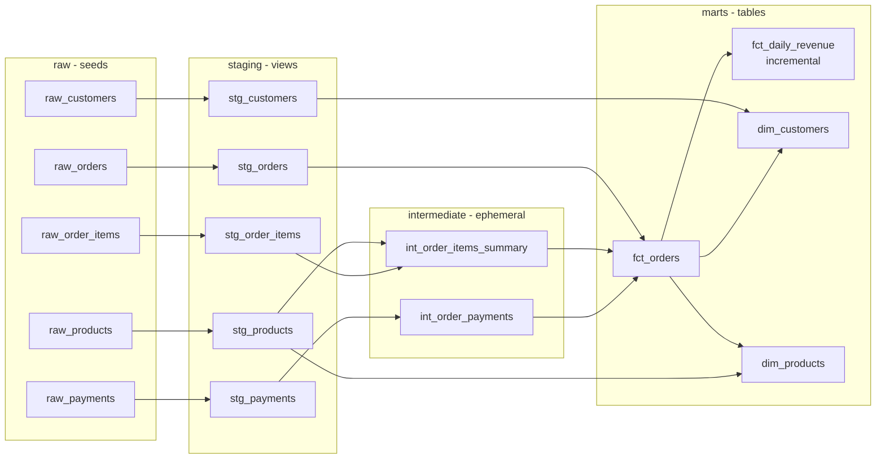

# Retail Analytics Warehouse with dbt + DuckDB

[](https://github.com/kaajjalchoudhary/retail-analytics-dbt/actions/workflows/ci.yml)


An analytics-engineering project that models raw extracts from a fictional online clothing store into
a tested **star schema** with dbt. It runs entirely on your laptop with DuckDB: no cloud account
or database server needed.

The raw data is intentionally messy (duplicate order rows, inconsistent casing and whitespace,
failed and split payments, amounts in cents), and the staging layer handles all of it.

## Lineage



## Models

| Layer | Model | Grain | Highlights |
|---|---|---|---|
| staging | `stg_orders` | order | Deduplicates repeated loads with `row_number()` and keeps the latest status |
| staging | `stg_payments` | payment attempt | Converts cents to dollars with a reusable macro |
| staging | `stg_customers` | customer | Normalises emails, names and country codes |
| intermediate | `int_order_items_summary` | order | Item count, units, order total and cost |
| intermediate | `int_order_payments` | order | Amount paid, failed attempts, split / gift-card payments |
| marts | `fct_orders` | order | Order fact with gross margin and payment details |
| marts | `fct_daily_revenue` | day | **Incremental** (`delete+insert`), reprocesses only the last 3 days |
| marts | `dim_customers` | customer | Lifetime value, recency and segment (prospect / new / loyal / champion / at_risk) |
| marts | `dim_products` | product | Units, revenue, margin, overall and in-category rank |

## Results

Output of `make query` (the same numbers CI prints on every run):

```
== Revenue by year ==
│ year │ orders │  revenue  │ margin_pct │
│ 2023 │    292 │  97228.23 │       54.2 │
│ 2024 │    955 │ 310405.56 │       54.1 │

== Customer segments ==
│ customer_segment │ customers │ avg_ltv │
│ loyal            │       126 │ 1387.84 │
│ prospect         │        60 │    0.00 │
│ at_risk          │        54 │  870.12 │
│ champion         │        45 │ 4010.40 │
│ new              │        15 │  354.12 │

== Top 5 products ==
│ rank │ product_name │ category    │ units_sold │  revenue │
│    1 │ Rain Jacket  │ Outerwear   │        154 │ 36036.00 │
│    2 │ Leather Belt │ Accessories │        161 │ 35098.00 │
│    3 │ Knit Polo    │ Tops        │        130 │ 32238.70 │
│    4 │ Sunglasses   │ Accessories │        157 │ 31635.50 │
│    5 │ Trench Coat  │ Outerwear   │        173 │ 30794.00 │
```

`dbt build` result: `PASS=53 WARN=0 ERROR=0` (5 seeds, 9 models, 39 tests).

## Data quality

`dbt build` runs **39 tests** and fails the pipeline if any of them fail:

- **Generic tests**: `unique`, `not_null`, `accepted_values`, `relationships` (foreign keys
  between every layer).
- **Custom generic test**: `is_positive` (`tests/generic/is_positive.sql`) for quantities, prices and
  amounts.
- **Singular tests**:
  - `assert_paid_orders_are_fully_paid`: successful payments must equal the order total for every
    fulfilled order (this catches broken split-payment or cents-conversion logic).
  - `assert_no_orders_before_signup`: customers cannot order before they have an account.

## Quick start

```bash
git clone https://github.com/kaajjalchoudhary/retail-analytics-dbt.git
cd retail-analytics-dbt
python -m venv .venv && source .venv/bin/activate
make install

make build   # generate seed CSVs, then dbt seed + run + test
make query   # print headline numbers from the marts
make docs    # browse the dbt docs site and lineage graph
```

The warehouse is a single file, `warehouse.duckdb`. Open it with the DuckDB CLI or any SQL client:

```sql
select customer_segment, count(*), round(avg(lifetime_value), 2)
from marts.dim_customers
group by 1;
```

## Project structure

```
├── models/
│   ├── staging/        # 1:1 with sources: rename, cast, clean, dedupe
│   ├── intermediate/   # reusable building blocks (ephemeral)
│   └── marts/          # facts and dimensions for BI
├── macros/             # cents_to_dollars, generate_schema_name
├── tests/              # singular tests + custom generic test
├── seeds/_seeds.yml    # seed column types and descriptions
├── scripts/            # seed data generator, query helper
└── .github/workflows/ci.yml   # dbt build + docs artifact on every push
```

## Design decisions

- **Seeds are generated, not committed.** `scripts/generate_seeds.py` is deterministic (fixed random
  seed), so every run builds the same warehouse while keeping the repo small.
- **Ephemeral intermediates** keep the warehouse clean: only staging views and mart tables are
  materialised.
- **Revenue excludes returns and cancellations** (`is_revenue_order`), but `fct_orders` keeps every
  order so analysts can still study returns.
- **Reproducible recency**: customer recency is measured against the latest order in the data, not
  `current_date`, so segments don't drift over time.
